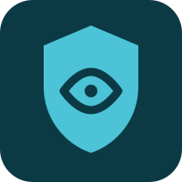
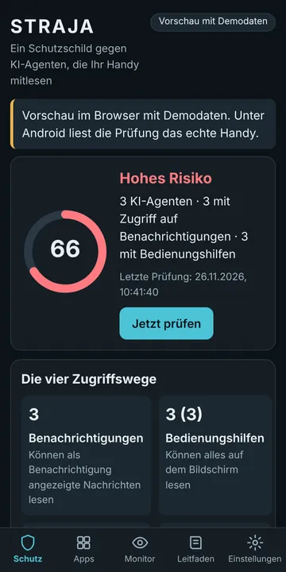
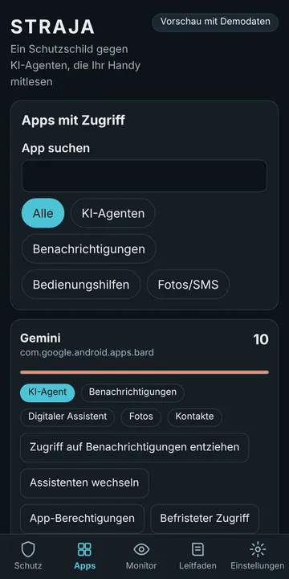
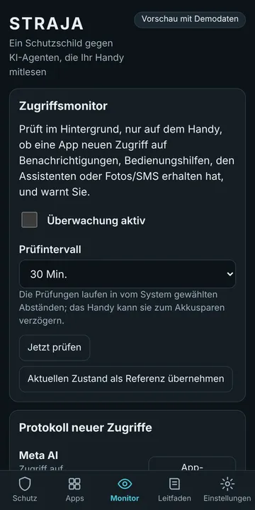
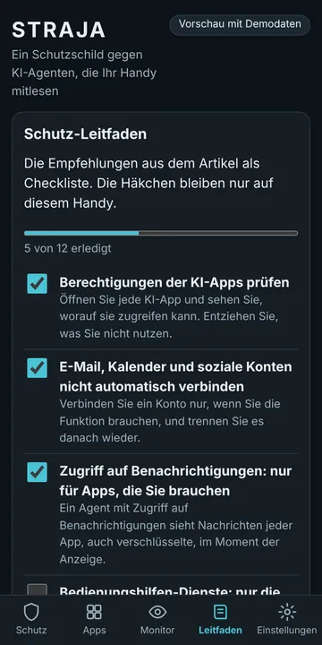

# STRAJA

[English](README.md) · [Română](README.ro.md) · [Français](README.fr.md) · [Italiano](README.it.md) · [Español](README.es.md) · [Português](README.pt.md) · **Deutsch** · [Magyar](README.hu.md)

> **Ein Schutzschild gegen KI-Agenten, die Ihr Handy mitlesen**

_Version: 1.0.1 · 2026-11-26_

STRAJA zeigt, welche Apps Ihre Benachrichtigungen, Ihren Bildschirm, Ihre Fotos und SMS lesen können, warnt Sie, wenn eine neue Zugriff erhält, und führt Sie zur genauen Einstellungsseite, um ihn zu entziehen. Offline, ohne Konten, ohne Internet-Berechtigung.

**[APK herunterladen (Android)](https://github.com/chiuta/STRAJA/releases/latest/download/STRAJA-android.apk) · [IPA herunterladen (iPhone, unsigniert)](https://github.com/chiuta/STRAJA/releases/latest/download/STRAJA-ios-unsigned.ipa) · [Quellcode auf GitHub](https://github.com/chiuta/STRAJA)**

   

## Warum es STRAJA gibt

Im November 2026 warnte ein Presseartikel, dass KI-Agenten mit den passenden Berechtigungen mitlesen können, was auf dem Handy erscheint: Nachrichten verschlüsselter Apps, Fotos, Benachrichtigungen. Die Verschlüsselung ist nicht geknackt; der Inhalt wird gelesen, wenn er angezeigt wird. STRAJA macht aus der Warnung etwas, das Sie prüfen und beheben können.

## Die vier Zugriffswege

1. **Benachrichtigungen** — Ein Benachrichtigungs-Listener sieht jede Nachricht im Moment der Anzeige, egal von welcher App.
2. **Bedienungshilfen** — Ein Bedienungshilfen-Dienst kann den ganzen Bildschirm lesen und für Sie tippen.
3. **Digitaler Assistent** — Der Standard-Assistent kann den Bildschirmtext oder einen Screenshot erhalten.
4. **Fotos und SMS** — Berechtigungen für Medien, Speicher und SMS legen Galerie und Textnachrichten offen.

## Funktionen

- **Zugriffsprüfung (Android)** — Listet Apps mit Zugriff auf Benachrichtigungen, Bedienungshilfen-Diensten, Assistentenrolle und Medien-/SMS-Berechtigungen, mit Risikowert pro App und für das ganze Handy.
- **Hintergrundmonitor** — Eine regelmäßige Prüfung vergleicht das Handy mit einer Referenz und meldet jeden neuen Zugriff. Nichts verlässt das Handy.
- **Ein Tipp zur richtigen Seite** — Öffnet genau die Systemeinstellung, in der Sie einen Zugriff entziehen; ändert nie etwas heimlich.
- **Befristeter Zugriff** — Geben Sie Zugriff für eine Aufgabe und erhalten Sie nach 15 Minuten, 1 Stunde, 4 Stunden oder einem Tag eine Erinnerung zum Entziehen.
- **Schutz-Leitfaden** — Eine Checkliste mit 12 Punkten aus dem Artikel, wöchentliche Erinnerung, Signal-Bildschirmschutz und eine Nachricht für Ihre Kontakte.
- **Privat von Grund auf** — Keine INTERNET-Berechtigung, kein Backup, Screenshots der App selbst blockiert, 8 Sprachen, helles und dunkles Design.

## Schnellstart

1. Laden Sie die APK (Android) oder die unsignierte IPA (iPhone, Installation mit AltStore oder Sideloadly) aus dem neuesten Release herunter.
2. Öffnen Sie STRAJA und tippen Sie auf Jetzt prüfen (Android) oder öffnen Sie den Leitfaden (iPhone).
3. Öffnen Sie die App-Liste, tippen Sie eine App an und folgen Sie der Schaltfläche, um Unnötiges zu entziehen.
4. Schalten Sie Monitor und wöchentliche Erinnerung ein.

_Die iPhone-Datei ist nicht mit einem Apple-Entwicklerzertifikat signiert; Sideloading-Werkzeuge signieren sie mit Ihrer eigenen Apple-ID._

## Ehrliche Grenzen

- STRAJA kann einen Agenten nicht stoppen. Android und iOS erlauben einer App nicht, den Zugriff einer anderen zu entziehen; sie zeigt, warnt und führt Sie zur richtigen Seite.
- Sie kann Screenshots anderer Apps nicht blockieren. Nur der eigene Bildschirm ist geschützt.
- iPhone: iOS verbirgt die Berechtigungen anderer Apps, daher gibt es keine Prüfung, nur den Leitfaden, ein manuelles Register und Erinnerungen.
- Die Liste bekannter KI-Agenten ist nur ein Anhaltspunkt. Markieren Sie Fehlendes von Hand.

## Build

Benötigt Node 24 oder neuer und JDK 21. Führen Sie npm install, npm test und dann npx cap sync aus. Der GitHub-Actions-Workflow baut die signierte APK und die unsignierte IPA und hängt sie an jedes v*-Tag.

## Datenschutz

Keine Analyse, keine Server, keine Konten und keine INTERNET-Berechtigung: Die App kann nichts nach außen senden. Alles, was sie anzeigt, bleibt auf dem Handy, und das Android-Backup ist deaktiviert.

## Dokumentation

- [Änderungsprotokoll](CHANGELOG.md)
- [Quellcode](https://github.com/chiuta/STRAJA)
- [Releases](https://github.com/chiuta/STRAJA/releases)
- [Site](https://straja.chiuta.ro/)

## Projekt unterstützen

STRAJA ist kostenlos und trade-free. Wenn sie Ihnen hilft, können Sie dem Autor einen Kaffee spendieren: <https://buymeacoffee.com/echo.of.the.strings>

## Lizenz

MIT © Alexandru‑Ionuț Chiuță (Alexio).
