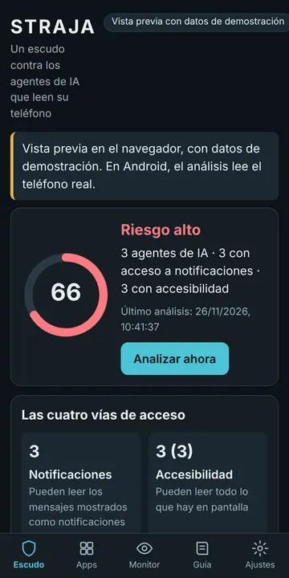
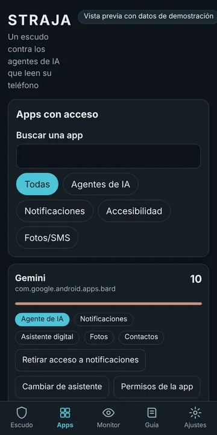
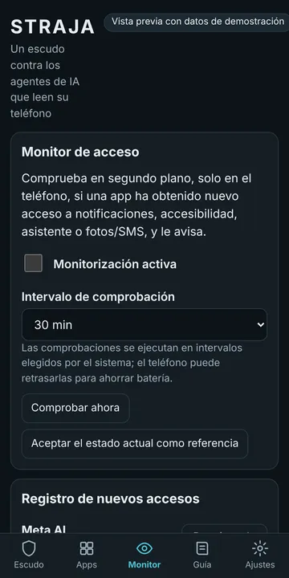
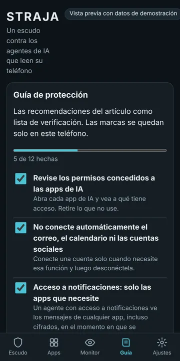

# STRAJA

[English](README.md) · [Română](README.ro.md) · [Français](README.fr.md) · [Italiano](README.it.md) · **Español** · [Português](README.pt.md) · [Deutsch](README.de.md) · [Magyar](README.hu.md)

> **Un escudo contra los agentes de IA que leen tu teléfono**

_Version: 1.0.0 · 2026-11-26_

STRAJA te muestra qué apps pueden leer tus notificaciones, tu pantalla, tus fotos y tus SMS, te avisa cuando una nueva obtiene acceso y te lleva a la pantalla exacta de ajustes para retirarlo. Sin conexión, sin cuentas, sin permiso de Internet.

**[Descargar APK (Android)](https://github.com/chiuta/STRAJA/releases/latest/download/STRAJA-android.apk) · [Descargar IPA (iPhone, sin firmar)](https://github.com/chiuta/STRAJA/releases/latest/download/STRAJA-ios-unsigned.ipa) · [Código en GitHub](https://github.com/chiuta/STRAJA)**

   

## Por qué existe STRAJA

En noviembre de 2026 un artículo de prensa advertía de que los agentes de IA con los permisos adecuados pueden leer lo que aparece en el teléfono: mensajes de apps cifradas, fotos, notificaciones. El cifrado no está roto; el contenido se lee cuando se muestra. STRAJA convierte esa advertencia en algo que puedes comprobar y corregir.

## Las cuatro vías de acceso

1. **Notificaciones** — Un oyente de notificaciones ve cada mensaje en el instante en que se muestra, sea cual sea la app.
2. **Accesibilidad** — Un servicio de accesibilidad puede leer toda la pantalla y tocar por ti.
3. **Asistente digital** — El asistente predeterminado puede recibir el texto de la pantalla o una captura.
4. **Fotos y SMS** — Los permisos de medios, almacenamiento y SMS exponen tu galería y tus mensajes.

## Funciones

- **Auditoría de accesos (Android)** — Lista las apps con acceso a notificaciones, servicios de accesibilidad, rol de asistente y permisos de medios/SMS, con una puntuación de riesgo por app y para todo el teléfono.
- **Monitor en segundo plano** — Una comprobación periódica compara el teléfono con una referencia y te avisa de cada acceso nuevo. Nada sale del teléfono.
- **Un toque hasta la pantalla correcta** — Abre la página exacta de ajustes del sistema para retirar un acceso; nunca cambia nada en silencio.
- **Acceso temporal** — Concede acceso para una tarea y recibe un recordatorio para retirarlo a los 15 minutos, 1 hora, 4 horas o un día.
- **Guía de protección** — Una lista de 12 puntos del artículo, recordatorio semanal, seguridad de pantalla de Signal y un mensaje para tus contactos.
- **Privada por diseño** — Sin permiso INTERNET, sin copia de seguridad, capturas de la propia app bloqueadas, 8 idiomas, temas claro y oscuro.

## Inicio rápido

1. Descarga el APK (Android) o el IPA sin firmar (iPhone, para instalar con AltStore o Sideloadly) de la última versión.
2. Abre STRAJA y toca Analizar ahora (Android) o abre la Guía (iPhone).
3. Abre la lista de apps, toca una y sigue el botón para retirar lo que no necesita.
4. Activa el monitor y el recordatorio semanal.

_El archivo para iPhone no está firmado con un certificado de desarrollador de Apple; las herramientas de instalación lo firman con tu propio Apple ID._

## Límites honestos

- STRAJA no puede detener a un agente. Android e iOS no permiten que una app retire el acceso de otra; muestra, avisa y te lleva a la pantalla correcta.
- No puede bloquear las capturas hechas por otras apps. Solo su propia pantalla está protegida.
- iPhone: iOS oculta los permisos de otras apps, así que no hay auditoría, solo la guía, un registro manual y recordatorios.
- La lista de agentes de IA conocidos es orientativa. Marca a mano lo que falte.

## Compilación

Requiere Node 24 o posterior y JDK 21. Ejecuta npm install, npm test y luego npx cap sync. El flujo de GitHub Actions construye el APK firmado y el IPA sin firmar y los adjunta a cada etiqueta v*.

## Privacidad

Sin analítica, sin servidores, sin cuentas y sin permiso INTERNET: la app no puede enviar nada al exterior. Todo lo que muestra se queda en el teléfono y la copia de seguridad de Android está desactivada.

## Documentación

- [Registro de cambios](CHANGELOG.md)
- [Código fuente](https://github.com/chiuta/STRAJA)
- [Versiones](https://github.com/chiuta/STRAJA/releases)
- [Site](https://chiuta.github.io/STRAJA/)

## Apoya el proyecto

STRAJA es gratuita y trade-free. Si te sirve, puedes invitar un café al autor: <https://buymeacoffee.com/echo.of.the.strings>

## Licencia

MIT © Alexandru‑Ionuț Chiuță (Alexio).
