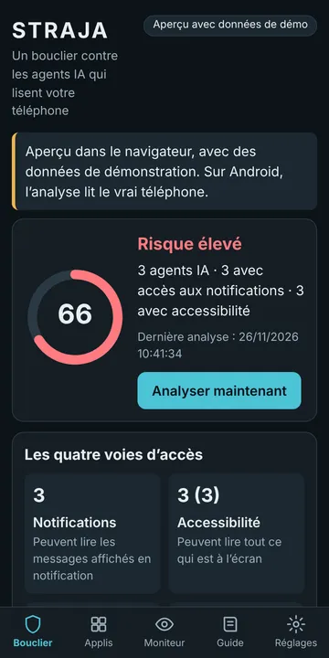
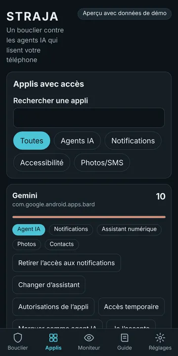
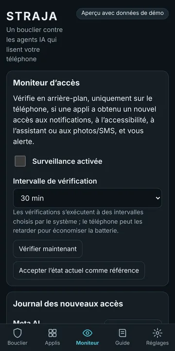
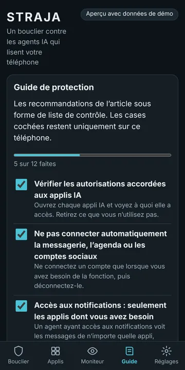

# STRAJA

[English](README.md) · [Română](README.ro.md) · **Français** · [Italiano](README.it.md) · [Español](README.es.md) · [Português](README.pt.md) · [Deutsch](README.de.md) · [Magyar](README.hu.md)

> **Un bouclier contre les agents IA qui lisent votre téléphone**

_Version: 1.0.0 · 2026-11-26_

STRAJA montre quelles applications peuvent lire vos notifications, votre écran, vos photos et vos SMS, vous prévient quand une nouvelle obtient un accès et vous amène à l'écran exact des réglages pour le retirer. Hors ligne, sans compte, sans permission Internet.

**[Télécharger l'APK (Android)](https://github.com/chiuta/STRAJA/releases/latest/download/STRAJA-android.apk) · [Télécharger l'IPA (iPhone, non signé)](https://github.com/chiuta/STRAJA/releases/latest/download/STRAJA-ios-unsigned.ipa) · [Code source sur GitHub](https://github.com/chiuta/STRAJA)**

   

## Pourquoi STRAJA existe

En novembre 2026, un article de presse alertait : des agents IA dotés des bonnes permissions peuvent lire ce qui s'affiche sur le téléphone, messages d'applications chiffrées, photos, notifications. Le chiffrement n'est pas cassé ; le contenu est lu au moment où il s'affiche. STRAJA transforme cette alerte en quelque chose que l'on peut vérifier et corriger.

## Les quatre voies d'accès

1. **Notifications** — Un écouteur de notifications voit chaque message à l'instant où il s'affiche, quelle que soit l'application.
2. **Accessibilité** — Un service d'accessibilité peut lire tout l'écran et toucher à votre place.
3. **Assistant numérique** — L'assistant par défaut peut recevoir le texte de l'écran ou une capture.
4. **Photos et SMS** — Les permissions médias, stockage et SMS exposent votre galerie et vos messages.

## Fonctions

- **Audit des accès (Android)** — Liste les applications ayant accès aux notifications, services d'accessibilité, rôle d'assistant et permissions médias/SMS, avec un score de risque par application et pour tout le téléphone.
- **Surveillance en arrière-plan** — Un contrôle périodique compare le téléphone à une référence et vous avertit de chaque nouvel accès. Rien ne quitte le téléphone.
- **Une touche jusqu'au bon écran** — Ouvre la page exacte des réglages système pour retirer un accès ; ne modifie jamais rien en silence.
- **Accès temporaire** — Accordez un accès pour une tâche et recevez un rappel pour le retirer après 15 minutes, 1 heure, 4 heures ou un jour.
- **Guide de protection** — Une liste de 12 points tirée de l'article, un rappel hebdomadaire, la sécurité d'écran de Signal et un message à envoyer à vos contacts.
- **Privée par conception** — Pas de permission INTERNET, pas de sauvegarde, captures d'écran de l'application bloquées, 8 langues, thèmes clair et sombre.

## Démarrage rapide

1. Téléchargez l'APK (Android) ou l'IPA non signé (iPhone, à installer avec AltStore ou Sideloadly) depuis la dernière version.
2. Ouvrez STRAJA et touchez Analyser maintenant (Android) ou ouvrez le Guide (iPhone).
3. Ouvrez la liste des applications, touchez-en une et suivez le bouton pour retirer ce dont elle n'a pas besoin.
4. Activez la surveillance et le rappel hebdomadaire.

_Le fichier iPhone n'est pas signé avec un certificat développeur Apple ; les outils d'installation le signent avec votre propre identifiant Apple._

## Limites honnêtes

- STRAJA ne peut pas arrêter un agent. Android et iOS ne permettent pas à une application de retirer l'accès d'une autre ; elle montre, prévient et vous mène au bon écran.
- Elle ne peut pas bloquer les captures faites par d'autres applications. Seul son propre écran est protégé.
- iPhone : iOS cache les permissions des autres applications, donc pas d'audit, seulement le guide, un registre manuel et des rappels.
- La liste des agents IA connus est indicative. Marquez à la main ce qui manque.

## Construction

Nécessite Node 24 ou plus récent et JDK 21. Lancez npm install, npm test, puis npx cap sync. Le workflow GitHub Actions construit l'APK signé et l'IPA non signé et les joint à chaque étiquette v*.

## Confidentialité

Ni analytique, ni serveurs, ni comptes, ni permission INTERNET : l'application ne peut rien envoyer à l'extérieur. Tout ce qu'elle affiche reste sur le téléphone, et la sauvegarde Android est désactivée.

## Documentation

- [Journal des modifications](CHANGELOG.md)
- [Code source](https://github.com/chiuta/STRAJA)
- [Versions](https://github.com/chiuta/STRAJA/releases)
- [Site](https://straja.chiuta.ro/)

## Soutenir le projet

STRAJA est gratuite et trade-free. Si elle vous aide, vous pouvez offrir un café à l'auteur : <https://buymeacoffee.com/echo.of.the.strings>

## Licence

MIT © Alexandru‑Ionuț Chiuță (Alexio).
