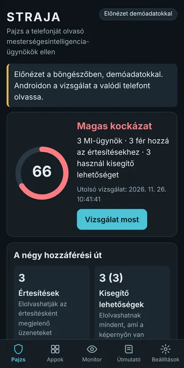
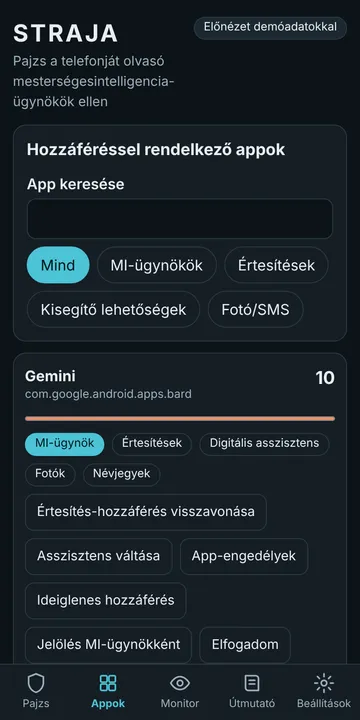
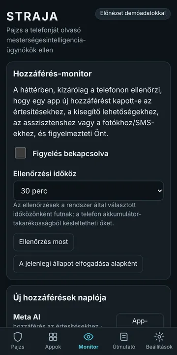
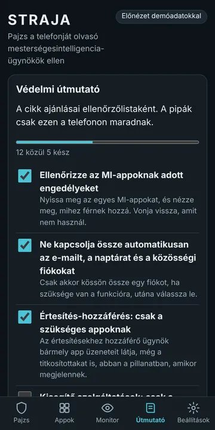

# STRAJA

[English](README.md) · [Română](README.ro.md) · [Français](README.fr.md) · [Italiano](README.it.md) · [Español](README.es.md) · [Português](README.pt.md) · [Deutsch](README.de.md) · **Magyar**

> **Pajzs a telefonját olvasó mesterségesintelligencia-ügynökök ellen**

_Version: 1.0.0 · 2026-11-26_

A STRAJA megmutatja, mely appok olvashatják az értesítéseit, a képernyőjét, a fotóit és az SMS-eit, figyelmeztet, ha egy újabb hozzáférést kap, és elvisz a beállítások pontos képernyőjére, ahol visszavonhatja. Offline, fiókok nélkül, internetengedély nélkül.

**[APK letöltése (Android)](https://github.com/chiuta/STRAJA/releases/latest/download/STRAJA-android.apk) · [IPA letöltése (iPhone, aláíratlan)](https://github.com/chiuta/STRAJA/releases/latest/download/STRAJA-ios-unsigned.ipa) · [Forráskód a GitHubon](https://github.com/chiuta/STRAJA)**

   

## Miért van STRAJA

2026 novemberében egy sajtócikk arra figyelmeztetett, hogy a megfelelő engedélyekkel rendelkező MI-ügynökök elolvashatják, ami a telefonon megjelenik: titkosított appok üzeneteit, fotókat, értesítéseket. A titkosítást nem törték fel; a tartalmat megjelenítéskor olvassák el. A STRAJA a figyelmeztetést olyasmivé alakítja, amit ellenőrizhet és kijavíthat.

## A négy hozzáférési út

1. **Értesítések** — Az értesítésfigyelő minden üzenetet abban a pillanatban lát, amikor megjelenik, bármelyik appról is jön.
2. **Kisegítő lehetőségek** — A kisegítő szolgáltatás elolvashatja az egész képernyőt, és helyette koppinthat.
3. **Digitális asszisztens** — Az alapértelmezett asszisztens megkaphatja a képernyő szövegét vagy egy képernyőképet.
4. **Fotók és SMS** — A média-, tárhely- és SMS-engedélyek feltárják a galériát és a szöveges üzeneteket.

## Funkciók

- **Hozzáférés-vizsgálat (Android)** — Kilistázza az értesítésekhez, kisegítő szolgáltatásokhoz, asszisztensi szerepkörhöz és média/SMS-engedélyekhez hozzáférő appokat, appenkénti és az egész telefonra vonatkozó kockázati pontszámmal.
- **Háttérmonitor** — Időszakos ellenőrzés hasonlítja össze a telefont egy alappal, és minden új hozzáférésről értesíti. Semmi nem hagyja el a telefont.
- **Egy koppintás a megfelelő képernyőig** — Megnyitja a rendszerbeállítások pontos oldalát a hozzáférés visszavonásához; soha nem változtat semmit titokban.
- **Ideiglenes hozzáférés** — Adjon hozzáférést egy feladatra, és 15 perc, 1 óra, 4 óra vagy egy nap múlva emlékeztetőt kap a visszavonásra.
- **Védelmi útmutató** — 12 pontos ellenőrzőlista a cikkből, heti emlékeztető, a Signal képernyővédelme és egy üzenet az ismerőseinek.
- **Tervezésből privát** — Nincs INTERNET-engedély, nincs biztonsági mentés, az app saját képernyőképei tiltottak, 8 nyelv, világos és sötét téma.

## Gyors indulás

1. Töltse le az APK-t (Android) vagy az aláíratlan IPA-t (iPhone, AltStore-ral vagy Sideloadly-val telepíthető) a legfrissebb kiadásból.
2. Nyissa meg a STRAJA-t, és koppintson a Vizsgálat most gombra (Android), vagy nyissa meg az Útmutatót (iPhone).
3. Nyissa meg az appok listáját, koppintson egy appra, és a gombbal vonja vissza, amire nincs szüksége.
4. Kapcsolja be a monitort és a heti emlékeztetőt.

_Az iPhone-fájl nincs Apple fejlesztői tanúsítvánnyal aláírva; a telepítőeszközök a saját Apple-azonosítójával írják alá._

## Őszinte korlátok

- A STRAJA nem tud megállítani egy ügynököt. Az Android és az iOS nem engedi, hogy egy app visszavonja a másikét; megmutatja, figyelmeztet, és a megfelelő képernyőre viszi.
- Nem tudja blokkolni más appok képernyőképeit. Csak a saját képernyője védett.
- iPhone: az iOS elrejti más appok engedélyeit, ezért nincs vizsgálat, csak az útmutató, kézi nyilvántartás és emlékeztetők.
- Az ismert MI-ügynökök listája tájékoztató jellegű. Ami hiányzik, jelölje meg kézzel.

## Építés

Node 24 vagy újabb és JDK 21 szükséges. Futtassa az npm install, npm test, majd az npx cap sync parancsot. A GitHub Actions munkafolyamat felépíti az aláírt APK-t és az aláíratlan IPA-t, és minden v* címkéhez csatolja.

## Adatvédelem

Nincs analitika, nincsenek szerverek, fiókok és INTERNET-engedély: az app semmit nem tud kiküldeni. Minden, amit mutat, a telefonon marad, az Android biztonsági mentés pedig ki van kapcsolva.

## Dokumentáció

- [Változásnapló](CHANGELOG.md)
- [Forráskód](https://github.com/chiuta/STRAJA)
- [Kiadások](https://github.com/chiuta/STRAJA/releases)
- [Site](https://straja.chiuta.ro/)

## Támogassa a projektet

A STRAJA ingyenes és trade-free. Ha hasznos, meghívhatja a szerzőt egy kávéra: <https://buymeacoffee.com/echo.of.the.strings>

## Licenc

MIT © Alexandru‑Ionuț Chiuță (Alexio).
