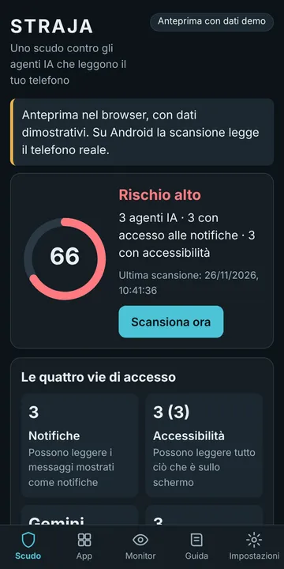
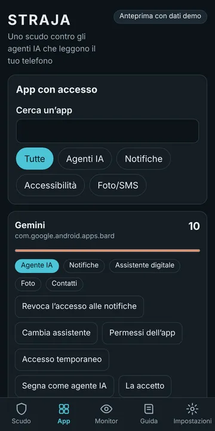
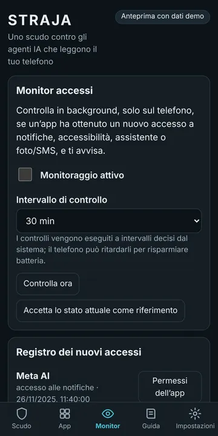
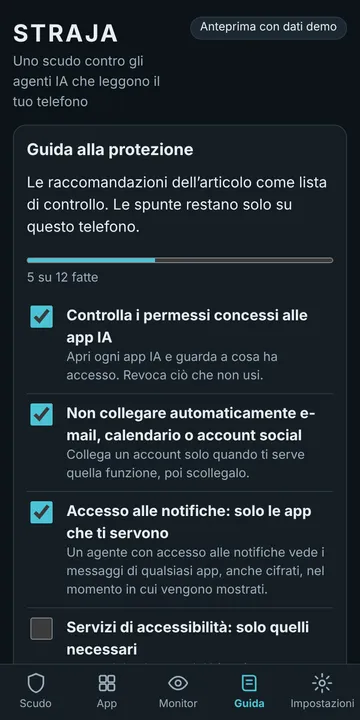

# STRAJA

[English](README.md) · [Română](README.ro.md) · [Français](README.fr.md) · **Italiano** · [Español](README.es.md) · [Português](README.pt.md) · [Deutsch](README.de.md) · [Magyar](README.hu.md)

> **Uno scudo contro gli agenti IA che leggono il tuo telefono**

_Version: 1.0.1 · 2026-11-26_

STRAJA mostra quali app possono leggere notifiche, schermo, foto e SMS, ti avvisa quando una nuova ottiene accesso e ti porta alla schermata esatta delle impostazioni per revocarlo. Offline, senza account, senza permesso Internet.

**[Scarica l'APK (Android)](https://github.com/chiuta/STRAJA/releases/latest/download/STRAJA-android.apk) · [Scarica l'IPA (iPhone, non firmato)](https://github.com/chiuta/STRAJA/releases/latest/download/STRAJA-ios-unsigned.ipa) · [Sorgente su GitHub](https://github.com/chiuta/STRAJA)**

   

## Perché esiste STRAJA

A novembre 2026 un articolo di stampa avvertiva che gli agenti IA con i permessi giusti possono leggere ciò che appare sul telefono: messaggi di app cifrate, foto, notifiche. La cifratura non è violata; il contenuto viene letto nel momento in cui è mostrato. STRAJA trasforma l'avvertimento in qualcosa che puoi verificare e correggere.

## Le quattro vie di accesso

1. **Notifiche** — Un ascoltatore di notifiche vede ogni messaggio nell'istante in cui viene mostrato, qualunque sia l'app.
2. **Accessibilità** — Un servizio di accessibilità può leggere tutto lo schermo e toccare al posto tuo.
3. **Assistente digitale** — L'assistente predefinito può ricevere il testo dello schermo o uno screenshot.
4. **Foto e SMS** — I permessi per media, archiviazione e SMS espongono la galleria e i messaggi.

## Funzioni

- **Audit degli accessi (Android)** — Elenca le app con accesso alle notifiche, servizi di accessibilità, ruolo di assistente e permessi media/SMS, con un punteggio di rischio per app e per l'intero telefono.
- **Monitor in background** — Un controllo periodico confronta il telefono con una base di riferimento e ti avvisa a ogni nuovo accesso. Nulla esce dal telefono.
- **Un tocco fino alla schermata giusta** — Apre la pagina esatta delle impostazioni di sistema per revocare un accesso; non cambia mai nulla di nascosto.
- **Accesso temporaneo** — Dai accesso per un compito e ricevi un promemoria per revocarlo dopo 15 minuti, 1 ora, 4 ore o un giorno.
- **Guida alla protezione** — Una lista di 12 punti tratta dall'articolo, promemoria settimanale, sicurezza dello schermo di Signal e un messaggio per i tuoi contatti.
- **Privata per progetto** — Nessun permesso INTERNET, nessun backup, screenshot dell'app bloccati, 8 lingue, temi chiaro e scuro.

## Avvio rapido

1. Scarica l'APK (Android) o l'IPA non firmato (iPhone, da installare con AltStore o Sideloadly) dall'ultima versione.
2. Apri STRAJA e tocca Analizza ora (Android) oppure apri la Guida (iPhone).
3. Apri l'elenco delle app, tocca un'app e segui il pulsante per revocare ciò che non le serve.
4. Attiva il monitor e il promemoria settimanale.

_Il file per iPhone non è firmato con un certificato sviluppatore Apple; gli strumenti di installazione lo firmano con il tuo Apple ID._

## Limiti onesti

- STRAJA non può fermare un agente. Android e iOS non permettono a un'app di revocare l'accesso di un'altra; mostra, avvisa e ti porta alla schermata giusta.
- Non può bloccare gli screenshot fatti da altre app. Solo il suo schermo è protetto.
- iPhone: iOS nasconde i permessi delle altre app, quindi niente audit, solo la guida, un registro manuale e promemoria.
- L'elenco degli agenti IA noti è indicativo. Segna a mano ciò che manca.

## Compilazione

Richiede Node 24 o successivo e JDK 21. Esegui npm install, npm test e poi npx cap sync. Il workflow GitHub Actions costruisce l'APK firmato e l'IPA non firmato e li allega a ogni tag v*.

## Privacy

Nessuna analisi, nessun server, nessun account e nessun permesso INTERNET: l'app non può inviare nulla all'esterno. Tutto ciò che mostra resta sul telefono e il backup Android è disattivato.

## Documentazione

- [Registro delle modifiche](CHANGELOG.md)
- [Codice sorgente](https://github.com/chiuta/STRAJA)
- [Versioni](https://github.com/chiuta/STRAJA/releases)
- [Site](https://straja.chiuta.ro/)

## Sostieni il progetto

STRAJA è gratuita e trade-free. Se ti è utile, puoi offrire un caffè all'autore: <https://buymeacoffee.com/echo.of.the.strings>

## Licenza

MIT © Alexandru‑Ionuț Chiuță (Alexio).
