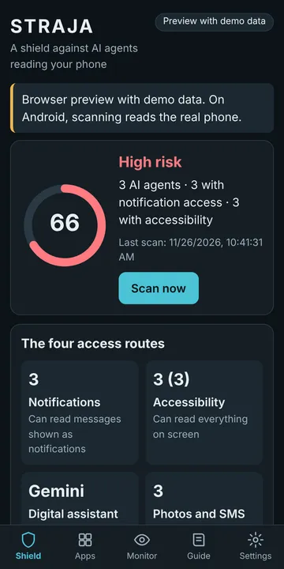
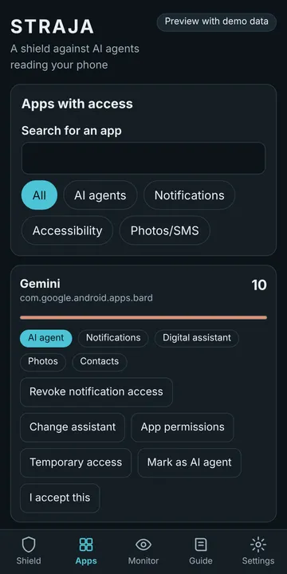
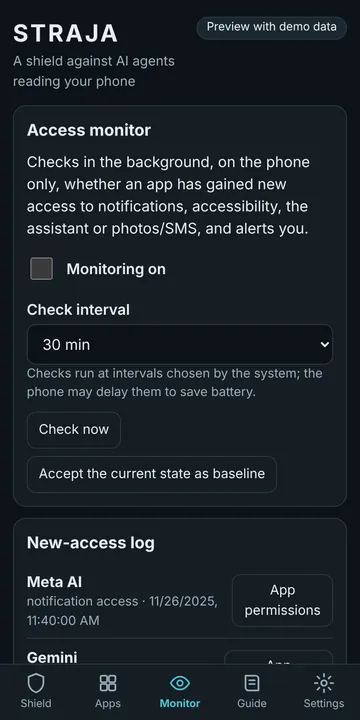
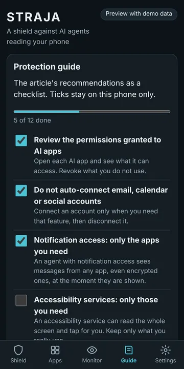

# STRAJA

**English** · [Română](README.ro.md) · [Français](README.fr.md) · [Italiano](README.it.md) · [Español](README.es.md) · [Português](README.pt.md) · [Deutsch](README.de.md) · [Magyar](README.hu.md)

> **A shield against AI agents that read your phone**

_Version: 1.0.0 · 2026-11-26_

STRAJA shows which apps can read your notifications, your screen, your photos and your SMS, warns you when a new one gets access, and walks you to the exact settings screen to revoke it. Offline, no accounts, no internet permission.

**[Download APK (Android)](https://github.com/chiuta/STRAJA/releases/latest/download/STRAJA-android.apk) · [Download IPA (iPhone, unsigned)](https://github.com/chiuta/STRAJA/releases/latest/download/STRAJA-ios-unsigned.ipa) · [Source on GitHub](https://github.com/chiuta/STRAJA)**

   

## Why STRAJA exists

In November 2026 a news article warned that AI agents with the right permissions can read what appears on your phone: messages from encrypted apps, photos, notifications. The encryption is not broken; the content is read when it is shown. STRAJA turns that warning into something you can check and act on.

## The four access routes

1. **Notifications** — A notification listener sees every message the moment it is displayed, whatever app sent it.
2. **Accessibility** — An accessibility service can read the whole screen and tap for you.
3. **Digital assistant** — The default assistant may receive the screen text or a screenshot.
4. **Photos and SMS** — Media, storage and SMS permissions expose your gallery and your texts.

## Features

- **Access audit (Android)** — Lists the apps with notification access, accessibility services, assistant role and media/SMS permissions, with a risk score per app and for the whole phone.
- **Background monitor** — A periodic check compares the phone with a baseline and notifies you about every new access. Nothing leaves the phone.
- **One tap to the right screen** — Opens the exact system settings page to revoke an access; it never silently changes anything.
- **Temporary access** — Grant access for one task and get a reminder to take it back after 15 minutes, 1 hour, 4 hours or a day.
- **Protection guide** — A 12-item checklist from the article, a weekly review reminder, Signal screen security, and a message to send to your contacts.
- **Private by design** — No INTERNET permission, no backup, screenshots of the app itself blocked, 8 languages, light and dark themes.

## Quick start

1. Download the APK (Android) or the unsigned IPA (iPhone, install with AltStore or Sideloadly) from the latest release.
2. Open STRAJA and tap Scan now (Android) or open the Guide (iPhone).
3. Open the apps list, tap an app and follow the button to revoke what it does not need.
4. Turn on the monitor and the weekly reminder.

_The iPhone file is not signed with an Apple developer certificate; sideloading tools sign it with your own Apple ID._

## Honest limits

- STRAJA cannot stop an agent. Android and iOS do not let one app revoke another's access; it shows, warns and takes you to the right screen.
- It cannot block screenshots taken by other apps. Only its own screen is protected.
- iPhone: iOS hides other apps' permissions, so there is no audit, only the guide, a manual registry and reminders.
- The list of known AI agents is indicative. Mark anything missing by hand.

## Build

Needs Node 24 or newer and JDK 21. Run npm install, npm test, then npx cap sync. The GitHub Actions workflow builds the signed APK and the unsigned IPA and attaches them to every v* tag.

## Privacy

No analytics, no servers, no accounts and no INTERNET permission: the app cannot send anything out. Everything it shows stays on the phone, and Android backup is disabled.

## Documentation

- [Changelog](CHANGELOG.md)
- [Source code](https://github.com/chiuta/STRAJA)
- [Releases](https://github.com/chiuta/STRAJA/releases)
- [Site](https://straja.chiuta.ro/)

## Support the project

STRAJA is free and trade-free. If it helps you, you can buy the author a coffee: <https://buymeacoffee.com/echo.of.the.strings>

## Licence

MIT © Alexandru‑Ionuț Chiuță (Alexio).
