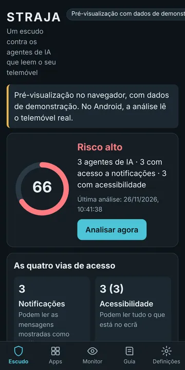
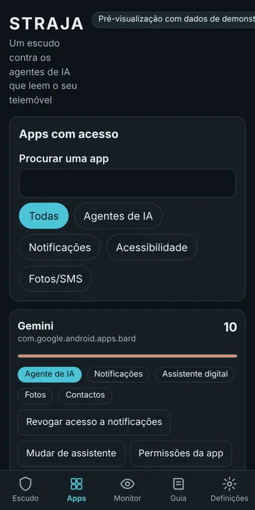
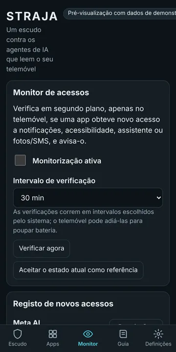
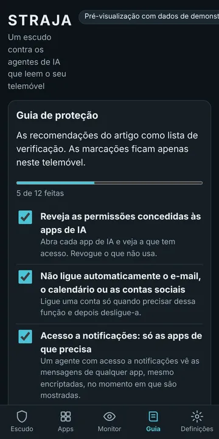

# STRAJA

[English](README.md) · [Română](README.ro.md) · [Français](README.fr.md) · [Italiano](README.it.md) · [Español](README.es.md) · **Português** · [Deutsch](README.de.md) · [Magyar](README.hu.md)

> **Um escudo contra os agentes de IA que leem o seu telemóvel**

_Version: 1.0.0 · 2026-11-26_

A STRAJA mostra que apps podem ler as suas notificações, o ecrã, as fotografias e os SMS, avisa-o quando uma nova obtém acesso e leva-o ao ecrã exato das definições para o revogar. Offline, sem contas, sem permissão de Internet.

**[Transferir APK (Android)](https://github.com/chiuta/STRAJA/releases/latest/download/STRAJA-android.apk) · [Transferir IPA (iPhone, não assinado)](https://github.com/chiuta/STRAJA/releases/latest/download/STRAJA-ios-unsigned.ipa) · [Código no GitHub](https://github.com/chiuta/STRAJA)**

   

## Porque existe a STRAJA

Em novembro de 2026, um artigo de imprensa alertava que os agentes de IA com as permissões certas podem ler o que aparece no telemóvel: mensagens de apps encriptadas, fotografias, notificações. A encriptação não foi quebrada; o conteúdo é lido quando é mostrado. A STRAJA transforma o alerta em algo que pode verificar e corrigir.

## As quatro vias de acesso

1. **Notificações** — Um ouvinte de notificações vê cada mensagem no instante em que é mostrada, seja qual for a app.
2. **Acessibilidade** — Um serviço de acessibilidade pode ler todo o ecrã e tocar por si.
3. **Assistente digital** — O assistente predefinido pode receber o texto do ecrã ou uma captura.
4. **Fotos e SMS** — As permissões de multimédia, armazenamento e SMS expõem a galeria e as mensagens.

## Funcionalidades

- **Auditoria de acessos (Android)** — Lista as apps com acesso a notificações, serviços de acessibilidade, função de assistente e permissões de multimédia/SMS, com uma pontuação de risco por app e para todo o telemóvel.
- **Monitor em segundo plano** — Uma verificação periódica compara o telemóvel com uma referência e avisa-o de cada novo acesso. Nada sai do telemóvel.
- **Um toque até ao ecrã certo** — Abre a página exata das definições do sistema para revogar um acesso; nunca altera nada em silêncio.
- **Acesso temporário** — Dê acesso para uma tarefa e receba um lembrete para o retirar passados 15 minutos, 1 hora, 4 horas ou um dia.
- **Guia de proteção** — Uma lista de 12 itens do artigo, lembrete semanal, proteção de ecrã do Signal e uma mensagem para os seus contactos.
- **Privada por conceção** — Sem permissão INTERNET, sem cópia de segurança, capturas da própria app bloqueadas, 8 idiomas, temas claro e escuro.

## Início rápido

1. Transfira o APK (Android) ou o IPA não assinado (iPhone, a instalar com AltStore ou Sideloadly) da última versão.
2. Abra a STRAJA e toque em Analisar agora (Android) ou abra o Guia (iPhone).
3. Abra a lista de apps, toque numa app e siga o botão para revogar o que não precisa.
4. Ative o monitor e o lembrete semanal.

_O ficheiro para iPhone não está assinado com um certificado de programador da Apple; as ferramentas de instalação assinam-no com o seu próprio Apple ID._

## Limites honestos

- A STRAJA não consegue parar um agente. O Android e o iOS não permitem que uma app revogue o acesso de outra; mostra, avisa e leva-o ao ecrã certo.
- Não consegue bloquear as capturas feitas por outras apps. Só o seu próprio ecrã está protegido.
- iPhone: o iOS esconde as permissões das outras apps, por isso não há auditoria, apenas o guia, um registo manual e lembretes.
- A lista de agentes de IA conhecidos é indicativa. Marque à mão o que faltar.

## Compilação

Requer Node 24 ou superior e JDK 21. Execute npm install, npm test e depois npx cap sync. O fluxo do GitHub Actions compila o APK assinado e o IPA não assinado e anexa-os a cada etiqueta v*.

## Privacidade

Sem análise, sem servidores, sem contas e sem permissão INTERNET: a app não consegue enviar nada para fora. Tudo o que mostra fica no telemóvel e a cópia de segurança do Android está desativada.

## Documentação

- [Registo de alterações](CHANGELOG.md)
- [Código-fonte](https://github.com/chiuta/STRAJA)
- [Versões](https://github.com/chiuta/STRAJA/releases)
- [Site](https://straja.chiuta.ro/)

## Apoie o projeto

A STRAJA é gratuita e trade-free. Se lhe for útil, pode oferecer um café ao autor: <https://buymeacoffee.com/echo.of.the.strings>

## Licença

MIT © Alexandru‑Ionuț Chiuță (Alexio).
