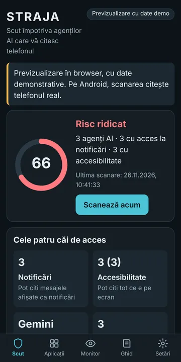
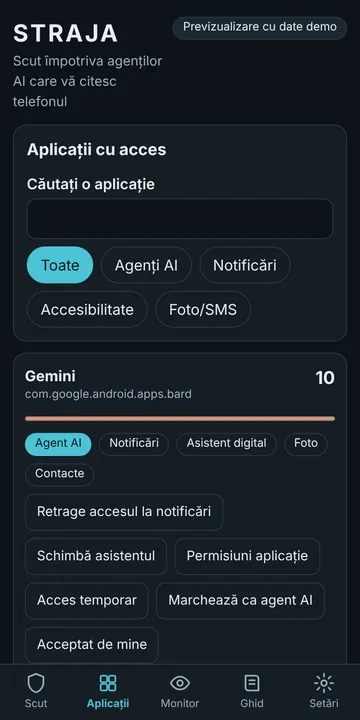
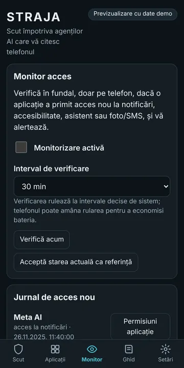
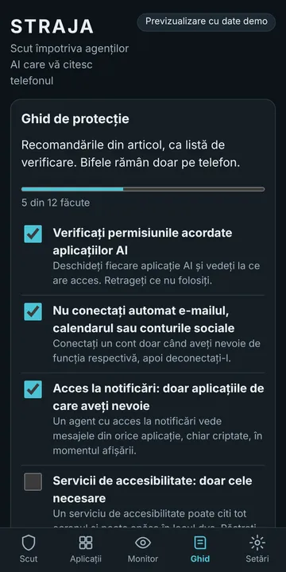

# STRAJA

[English](README.md) · **Română** · [Français](README.fr.md) · [Italiano](README.it.md) · [Español](README.es.md) · [Português](README.pt.md) · [Deutsch](README.de.md) · [Magyar](README.hu.md)

> **Un scut împotriva agenților AI care citesc telefonul tău**

_Version: 1.0.0 · 2026-11-26_

STRAJA îți arată ce aplicații pot citi notificările, ecranul, pozele și SMS-urile, te avertizează când una primește acces nou și te duce la ecranul exact din setări unde îl poți retrage. Offline, fără conturi, fără permisiunea INTERNET.

**[Descarcă APK (Android)](https://github.com/chiuta/STRAJA/releases/latest/download/STRAJA-android.apk) · [Descarcă IPA (iPhone, nesemnat)](https://github.com/chiuta/STRAJA/releases/latest/download/STRAJA-ios-unsigned.ipa) · [Sursa pe GitHub](https://github.com/chiuta/STRAJA)**

   

## De ce există STRAJA

În noiembrie 2026, un articol de presă avertiza că agenții AI cu permisiunile potrivite pot citi ce apare pe telefon: mesaje din aplicații criptate, poze, notificări. Criptarea nu e spartă; conținutul e citit în momentul în care este afișat. STRAJA transformă avertismentul în ceva ce poți verifica și rezolva.

## Cele patru căi de acces

1. **Notificări** — Un ascultător de notificări vede fiecare mesaj în clipa în care e afișat, indiferent de aplicația care l-a trimis.
2. **Accesibilitate** — Un serviciu de accesibilitate poate citi tot ecranul și poate atinge în locul tău.
3. **Asistent digital** — Asistentul implicit poate primi textul ecranului sau o captură.
4. **Poze și SMS** — Permisiunile pentru media, stocare și SMS expun galeria și mesajele text.

## Funcții

- **Audit de acces (Android)** — Listează aplicațiile cu acces la notificări, servicii de accesibilitate, rol de asistent și permisiuni media/SMS, cu un scor de risc pentru fiecare și pentru tot telefonul.
- **Monitor în fundal** — O verificare periodică compară telefonul cu o stare de referință și te anunță la fiecare acces nou. Nimic nu iese din telefon.
- **O atingere până la ecranul potrivit** — Deschide exact pagina de setări de sistem unde retragi un acces; nu schimbă nimic pe ascuns.
- **Acces temporar** — Dai acces pentru o sarcină și primești un memento să-l retragi după 15 minute, 1 oră, 4 ore sau o zi.
- **Ghid de protecție** — O listă de 12 puncte din articol, memento săptămânal, protecția ecranului în Signal și un mesaj pentru contactele tale.
- **Privată prin construcție** — Fără permisiunea INTERNET, fără backup, capturile de ecran ale aplicației sunt blocate, 8 limbi, teme deschisă și închisă.

## Pornire rapidă

1. Descarcă APK-ul (Android) sau IPA-ul nesemnat (iPhone, instalare cu AltStore sau Sideloadly) din ultima versiune.
2. Deschide STRAJA și atinge Analizează acum (Android) sau deschide Ghidul (iPhone).
3. Deschide lista de aplicații, atinge o aplicație și urmează butonul pentru a retrage ce nu-i trebuie.
4. Pornește monitorul și memento-ul săptămânal.

_Fișierul pentru iPhone nu este semnat cu un certificat de dezvoltator Apple; uneltele de instalare îl semnează cu propriul tău Apple ID._

## Limite oneste

- STRAJA nu poate opri un agent. Android și iOS nu permit unei aplicații să retragă accesul alteia; ea arată, avertizează și te duce la ecranul potrivit.
- Nu poate bloca capturile de ecran făcute de alte aplicații. Doar ecranul propriu este protejat.
- iPhone: iOS ascunde permisiunile altor aplicații, deci nu există audit, ci doar ghidul, un registru manual și memento-uri.
- Lista agenților AI cunoscuți este orientativă. Marchează manual ce lipsește.

## Construire

Necesită Node 24 sau mai nou și JDK 21. Rulează npm install, npm test, apoi npx cap sync. Fluxul GitHub Actions construiește APK-ul semnat și IPA-ul nesemnat și le atașează la fiecare etichetă v*.

## Confidențialitate

Fără analiză, fără servere, fără conturi și fără permisiunea INTERNET: aplicația nu poate trimite nimic în afară. Tot ce arată rămâne pe telefon, iar backup-ul Android este dezactivat.

## Documentație

- [Jurnal de modificări](CHANGELOG.md)
- [Cod sursă](https://github.com/chiuta/STRAJA)
- [Versiuni](https://github.com/chiuta/STRAJA/releases)
- [Site](https://straja.chiuta.ro/)

## Susține proiectul

STRAJA este gratuită și trade-free. Dacă îți este de folos, îi poți oferi autorului o cafea: <https://buymeacoffee.com/echo.of.the.strings>

## Licență

MIT © Alexandru‑Ionuț Chiuță (Alexio).
